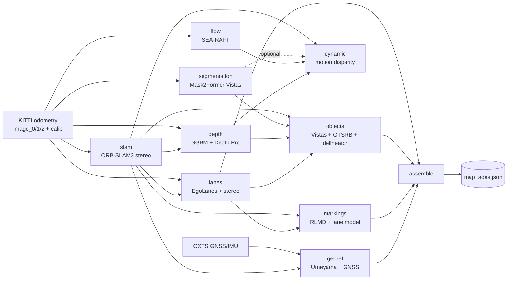

# aivision

Camera-based mapping and localization for automotive front cameras.

The repository contains three pipelines that build on each other:

1. **ADAS map generation** (`src/aivision/map/`, the main pipeline): stereo
   front-camera video + GNSS → a georeferenced map of static, ADAS-relevant
   objects (poles, signs, traffic lights, guide posts, ego-lane borders, road
   arrows).
2. **Map-based localization** (`map/localize.py`, `map/localize_sw.py`):
   GTSAM factor graphs that localize the vehicle inside that map from per-frame
   camera detections and a noisy GNSS fix.
3. **Monocular SfM** (`aivision` CLI): the original dashcam
   structure-from-motion stack (ORB VO, COLMAP, DISK + LightGlue, custom bundle
   adjustment). It is kept as a research track; the map pipeline does not
   depend on it.

The development and benchmark sequence is **KITTI odometry sequence 04**
(271 frames, straight drive; raw drive `2011_09_30_drive_0016`).

## Setup

```bash
uv sync                              # creates .venv and installs everything
uv run aivision download-models      # prefetch DISK + LightGlue into ./models/
```

All model weights are cached under `./models/` (gitignored). `aivision`
redirects `TORCH_HOME` / `HF_HOME` there automatically, so nothing leaks into
`~/.cache/`.

Not installed by `uv sync`:

| Dependency | Needed by | Where it is expected |
|---|---|---|
| ORB-SLAM3 `stereo_kitti` binary + ORB vocabulary | `slam` step | built locally under `external/orb_slam3/` (needs Pangolin, Eigen, OpenCV) |
| `ffmpeg` | depth step (FFV1 encode/decode), all video renders | on `PATH` |
| SEA-RAFT source | `flow` step | vendored at `models/sea_raft/` (checkpoint is pulled from the HF hub) |
| EgoLanes ONNX | `lanes` step | `models/ego_lanes/egolanes_fp32.onnx` |
| Road-marking weights | `markings` step | `models/road_marking/best.pt` (trained here, see [Road-marking detector](#road-marking-detector-training)) |
| KITTI seq 04 + OXTS | everything | `map/kitti-seq04/bindata/input/{odometry,oxts}` |
| `gsplat`, Blender 5.x | optional visualization scripts | not in `pyproject.toml` |

Verify the GPU is visible (CUDA PyTorch is installed by default):

```bash
uv run python -c "import torch; print(torch.cuda.is_available(), torch.cuda.get_device_name(0))"
```

---

## 1. ADAS map generation

### Overview

Map generation is a DAG of **roles**. Each role has a fixed output contract and
is filled by a swappable **method**; the pair `(role, type)` selects the
implementation from a registry. The recipe is
[`mapgen/kitti-seq04/config.json`](mapgen/kitti-seq04/config.json).



| # | Role | Type (method) | Models / algorithms | Output contract |
|---|---|---|---|---|
| 1 | `slam` | `ORB3` | ORB-SLAM3 stereo | `trajectory.json` (per-frame `Twc`) |
| 2 | `depth` | `inv-depth-fused-mono-rho-gf` | SGBM stereo, guided filter, pose-warped median fusion, Apple Depth Pro | `inv_depth_rho16.mkv`, `inv_depth_rho16_stereo.mkv` |
| 3 | `segmentation` | `mapillary-vistas` | Mask2Former Swin-L panoptic | `frame_NNNNNN.npz` (semantic + instance) |
| 4 | `flow` | `sea-raft` | SEA-RAFT (forward + backward) | `flow_NNNNNN.npz` |
| 5 | `dynamic` | `motion-disparity` | epipolar + looming residuals, Mask R-CNN, IoU tracker, temporal vote | `dynamic_NNNNNN.npz` (static / moving / unknown / pot_dyn) |
| 6 | `lanes` | `egolanes+gray-stereo` | EgoLanes, SGBM, RANSAC polynomial, Whittaker smoother | `lane_polylines.json`, `lane_polylines_model.json` |
| 7 | `objects` | `vistas+gtsrb+delineator` | Vistas connected components, GTSRB ViT, YOLOv12 delineator, union-find clustering, ray triangulation | `poles_signs_world.json` |
| 8 | `markings` | `rlmd+lanemodel` | YOLO11-seg (RLMD), least-squares plane, ray-plane lift, union-find, PCA | `arrows_world.json` |
| 9 | `georef` | `umeyama+gnss` | Umeyama similarity fit | `georef.json` (`T_map→ENU` + datum) |
| 10 | `assemble` | `ingest-v1` | format adapters + reframe to `f_veh_t0` | `map_adas.json` |

The `dynamic` step is part of the run but `assemble` does not read it: the map
holds static objects only. Its output feeds the renderers and the dynamic-free
dense cloud.

### Running it

There is no CLI wrapper; the generator is driven from Python:

```python
from aivision.map.mapgen import MapGen

gen = MapGen.from_name("kitti-seq04")        # loads mapgen/kitti-seq04/config.json
amap = gen.run()                             # full DAG, new run dir
amap = gen.run(only=["objects"], force=True, run_id="<existing-run>")   # redo one role
```

A step runs if its `(role, type)` is registered, it is selected, and its `out/`
is empty (or `force=True`); otherwise its existing `step.json` is folded into
the manifest. Per-role isolation tests live in `scripts/test_mapgen_*.py`.

```bash
uv run python scripts/verify_mapgen.py            # diff regenerated map vs map_adas.gt.json in ENU
uv run python scripts/render_mapgen_overlay.py    # reproject the map onto the RGB video
```

### Coordinate frames

| Frame | Convention | Used for |
|---|---|---|
| `M` (cam-world) | cam0 at frame 0; x-right, y-down, z-forward; metric | internal working frame of every lifting step (the ORB-SLAM3 world) |
| `f_veh_t0` | vehicle frame at frame 0; x-forward, y-left, z-up | frame of the final `map_adas.json` and of the localizers |
| `f_veh(t)` | vehicle frame at time `t` | virtual-camera sensor detections |
| ENU | local east/north/up about the OXTS datum (spherical equirectangular) | georeferencing, scoring, KML export |

All KITTI extrinsics and intrinsics come from one file,
`data/kitti/calibration_fveh.json` (built by `scripts/build_kitti_calibration.py`
from the raw KITTI calibration, loaded via `aivision.calibration.KittiCalibration`).

### Step 1 — `slam`: ORB-SLAM3 stereo

`steps_slam.py` → `pocs/orb_slam3.py`.

- **Algorithm:** ORB-SLAM3 (Campos et al., 2021) in stereo mode, run as the
  upstream `stereo_kitti` example binary in a subprocess on `image_0` /
  `image_1`.
- **Settings** (written to an OpenCV-FileStorage YAML from the sequence
  intrinsics): 2000 ORB features, scale factor 1.2, 8 pyramid levels, FAST
  thresholds 20 / 7, `Stereo.ThDepth` 35, baseline 0.5372 m.
- **Output:** the raw TUM-format `CameraTrajectory.txt` is folded into
  `trajectory.json`: one camera-to-world `Twc` (3×4, metric) per frame.

There is no neural network in this step. The only trained artefact is the
bag-of-words vocabulary; everything else is hand-crafted features plus
non-linear least squares.

**Keypoints: ORB (oriented FAST + rotated BRIEF)**, ORB-SLAM's own extractor
(`src/ORBextractor.cc`), not OpenCV's `cv::ORB`:

| Stage | What it does |
|---|---|
| Pyramid | 8 levels, scale 1.2 (coarsest ≈ 3.6× downsampled); the 2000-feature budget is split geometrically, most on the finest level |
| Detector | FAST-9/16 corners per ~35 px grid cell at threshold 20; a cell with no corner is retried at threshold 7, so low-texture road and sky still yield points |
| Distribution | quadtree subdivision per level, keeping the highest-response corner in each leaf, for even image coverage |
| Orientation | intensity centroid over a circular patch of radius 15 px |
| Descriptor | 256-bit steered BRIEF (rBRIEF, learned 31×31 test pattern) on the 7×7 Gaussian-blurred level; compared by Hamming distance |

**Stereo association** (`Frame::ComputeStereoMatches`): each left keypoint is
matched to right keypoints on the same row band by descriptor (Hamming < 75),
then refined to sub-pixel disparity by an 11×11 SAD window slid ±5 px with a
parabola fit; matches with SAD above 2.1× the median are dropped. Depth is
`bf / disparity`. Points closer than `ThDepth × baseline` = 35 × 0.537 ≈ 18.8 m
are "close" (trusted from a single stereo frame); farther ones are only
triangulated across views.

**Models:**

| Model | Choice |
|---|---|
| Camera | rectified pinhole, zero distortion, identical left/right intrinsics, pure-x baseline (`Camera.bf` = 0.5372 m × fx ≈ 379.8 px·m) |
| Motion | constant-velocity prediction to seed projection matching; falls back to bag-of-words matching against the reference keyframe, then relocalisation |
| Sensors | stereo only: no IMU, no GNSS, no wheel odometry |
| Place recognition | DBoW2 with the stock `ORBvoc.txt` (k = 10, depth 6, ≈ 1 M words, TF-IDF, L1 score); used for relocalisation and loop closing. Seq 04 is a straight drive, so no loop ever closes |
| Map | ORB-SLAM3 Atlas with one map; keyframes + covisibility graph + 3D map points |
| Optimiser | g2o Levenberg–Marquardt with Huber kernels. Per-frame pose-only optimisation (4 rounds × 10 iterations, outliers re-classified each round at χ² 5.991 mono / 7.815 stereo); local bundle adjustment over the covisible keyframe window in the mapping thread |

**Local patches to upstream** (commit `4452a3c`, UZ-SLAMLab/ORB_SLAM3):
`stereo_kitti.cc` dumps all surviving map points to `MapPoints.txt` before
shutdown (via an added `System::GetAtlas()`), `LoopClosing::mnFullBAIdx` is
fixed from `bool` to `int`, and the CMake files and `build.sh` are adjusted
for the local toolchain.

Stereo gives metric scale directly. On seq 04 the trajectory scores
ATE 0.19 m against KITTI ground truth after Sim(3) alignment
(`pocs/common.evaluate`).

### Step 2 — `depth`: fused inverse depth

`steps_depth.py`. Everything is carried as **ρ = 1/Z** (inverse depth, 1/m) and
Z is never materialised, so far and sky pixels stay numerically bounded.

1. **Stereo:** OpenCV **Semi-Global Block Matching** (`StereoSGBM`, 3-way mode,
   384 disparities, block 5, uniqueness 10, speckle filter 100/2,
   left-right check 1 px). `ρ = disparity / (fx · baseline)`.
2. **Edge-aware smoothing:** **guided filter** (`cv2.ximgproc.guidedFilter`,
   r = 4, ε = 1e-2) guided by the gray image, applied as a normalised
   convolution (filter `ρ·valid` and `valid`, divide) so invalid pixels carry
   no weight. It smooths only; nothing is inpainted.
3. **Temporal fusion:** the ρ maps of the ±5 neighbouring frames are warped
   into the current frame with the SLAM poses (z-buffered in ρ-space), and the
   per-pixel **median** is taken where at least 3 views agree.
4. **Mono fill:** **Apple Depth Pro** (`apple/DepthPro-hf`) predicts metric
   depth per frame. It is aligned to the stereo ρ with a per-frame **robust
   affine fit** (`ρ_stereo = a·ρ_mono + b`; least squares, drop the worst 10 %
   of residuals, refit) and fills only pixels where stereo is invalid.
5. **Encoding:** 16-bit lossless FFV1 MKV (`gray16le`). Pixel 0 = invalid,
   otherwise `ρ = (pixel − 1) / 65534`.

Two streams are written: the mono-filled one (used for object association) and
a **stereo-only** one. Motion reasoning reads the stereo-only stream, because
the mono model hallucinates a finite depth for sky.

### Step 3 — `segmentation`: Mapillary Vistas panoptic

`steps_seg.py` → `perception.build_perception_cache`.

- **Model:** **Mask2Former, Swin-L backbone**, fine-tuned on Mapillary Vistas
  panoptic (65 classes): `facebook/mask2former-swin-large-mapillary-vistas-panoptic`.
- Runs on the colour-left image (`image_2`) and writes per frame a `semantic`
  map (Vistas class ids, 255 = unknown) and an `instance` map.

### Step 4 — `flow`: dense optical flow

`steps_flow.py` → `flow.py`.

- **Model:** **SEA-RAFT** (Wang et al., ECCV 2024), Spring-M checkpoint
  `MemorySlices/Tartan-C-T-TSKH-spring540x960-M`, run at full resolution.
  `raft_large` (torchvision RAFT) is available as a fallback backend.
- For every consecutive pair both directions are cached (`fwd`: t→t+1,
  `bwd`: t+1→t) as float16. Flow is computed on `image_0` so it shares a frame
  with the SLAM pose and the stereo ρ.

### Step 5 — `dynamic`: dense motion segmentation

`steps_dynamic.py` → `motion_seg.py`, `detect.py`. Each pixel of every pair is
classified `static`, `moving`, `unknown` or `pot_dyn`. The decision is
geometric and class-independent: how far does the observed flow depart from the
rigid flow that ego-motion predicts?

1. **Dense geometric core** (`motion_seg`). Each cue is used only where it is
   trustworthy:
   - **Forward/backward consistency:** pixels whose fwd and bwd flow disagree
     (> 1.5 px + 5 % of flow magnitude) are occlusions → `unknown`.
   - **Epipolar (Sampson) residual**, depth-free: a static point stays on its
     epipolar line whatever its depth. > 2 px → `moving`. This also makes sky
     read as static without any depth.
   - **Looming residual** (rate of change of stereo ρ versus the static
     prediction): the only cue inside the 15° cone around the focus of
     expansion, where the epipolar test is blind (a vehicle straight ahead).
     Gated by a signal-to-noise check; without enough signal the pixel is
     `unknown`.
   - Flow > 80 px is treated as near-field and not trusted for the epipolar
     test.
   - **Despeckle:** moving components under 40 px are removed.
2. **Object recall** (`detect`). The dense core cannot see a fast oncoming car
   that moves along its epipolar lines without stereo depth.
   - **Mask R-CNN** (torchvision `maskrcnn_resnet50_fpn_v2`, COCO weights,
     score ≥ 0.5) detects cars, trucks, buses, persons, bicycles, motorcycles,
     trains.
   - A **greedy IoU tracker** (IoU ≥ 0.2, gap ≤ 5 frames) links detections.
   - **Ego-normalised closing ratio** `−dZ / v_ego`, with Z read from the
     stereo ρ of the road under the box: a static object closes at exactly ego
     speed (ratio ≈ 1). A track whose median ratio deviates by more than 0.5 is
     latched dynamic for life. Persons are always dynamic.
3. **Temporal vote:** labels are flow-warped across ±2 pairs and a class needs
   2 votes to be confirmed.
4. **Stamping:** each tracked object's mask is stamped `moving` (latched
   dynamic) or `pot_dyn` (a movable class not shown to move, e.g. a parked
   car).

`dynamic.py` holds the earlier region-level variant (median residual per
segmentation instance, tracked by flow-warped mask IoU with a sliding vote
window).

### Step 6 — `lanes`: ego-lane borders

`steps_lanes.py` → `ego_lanes.py`.

1. **Detection:** **EgoLanes** (Autoware Vision Pilot), an ONNX semantic
   segmentation net run with onnxruntime. Input 3×320×640, output three
   independent sigmoid masks at 1/4 resolution: ego-left border, ego-right
   border, other lanes. Only the two ego borders are used.
2. **Lift to 3D:** every lane pixel gets metric depth from gray-stereo **SGBM**
   (128 disparities, block 7), kept for 3 m < Z < 40 m, then transformed into
   the world frame with the SLAM pose.
3. **Raw border polylines** (`lane_polylines.json`): median X, Y per 3 m Z-bin
   (≥ 15 points), 1-2-1 binomial smoothing; left and right independent.
4. **Coupled lane model** (`lane_polylines_model.json`):
   - robust binning per 2 m with a 3·MAD outlier cut,
   - **RANSAC cubic polynomial** per border (300 iterations, 0.35 m inlier
     threshold) to reject bad bins,
   - reparametrise as centreline + half-width, then a **Whittaker smoother**
     (second-difference penalty) on centre (λ = 20), half-width (λ = 400) and
     height (λ = 80). The stiff width penalty keeps the two borders parallel.

The coupled model is what the map stores, and it doubles as the road surface
for the `markings` step. The lane is fitted from the data; it is never anchored
to the ego trajectory.

### Step 7 — `objects`: poles, signs, lights, guide posts

`steps_objects.py`.

1. **Per-frame detection:**
   - **Poles / street lights / utility poles** and **traffic lights**:
     connected components of the Vistas classes (ids 44, 45, 47 and 48) that
     are taller than wide (area ≥ 120 px, height ≥ 16 px).
   - **Traffic signs**: Vistas `Traffic Sign (Front)` regions are the
     proposals; each crop is classified by a **ViT image classifier trained on
     GTSRB** (`bazyl/gtsrb-model`, 43 German sign classes), confidence ≥ 0.40.
   - **Guide posts** (Leitpfosten): **YOLOv12x**
     (`maco018/YOLOv12_traffic-delineator`), confidence ≥ 0.25.
2. **Coarse 3D for association only:** median fused-ρ depth at the detection
   gives a noisy world position.
3. **Clustering:** **union-find single-linkage** across all frames (ε = 2.5 m
   poles, 3.5 m signs, 2.0 m guide posts), with a minimum number of
   observations per cluster.
4. **Fine 3D:** **robust least-squares ray triangulation**. The point closest
   to all bearing rays of the cluster is solved in closed form, rays with a
   residual above `max(1 m, 2.5 × median)` are dropped, and the fit is
   repeated. The long along-track baseline beats single-frame stereo.

### Step 8 — `markings`: road arrows

`steps_markings.py` → `road_marking.py`.

1. **Detection:** **YOLO11m-seg** trained in this repo on the **RLMD**
   road-marking dataset. Straight, left-straight and right-straight arrow
   instances are used (confidence ≥ 0.25).
2. **Ground plane from the lane model:** a local **least-squares plane**
   through the lane-model border points in the frame's forward window. Stereo
   depth at the arrow pixels is deliberately not used; painted road surface is
   low-texture and noisy.
3. **Lift:** each arrow-mask pixel is intersected with that plane
   (**ray-plane intersection**). An ego-lane gate keeps arrows whose centroid
   lies between the borders.
4. **Cluster + fit:** union-find across frames (ε = 2.0 m); per cluster a 3D
   pose from the centroid and a **PCA** heading clamped to the lane tangent,
   plus a sized arrow glyph.

### Step 9 — `georef`: map → Earth

`mapgen.GeorefStep` → `frame.GeoReference`.

- **Algorithm:** closed-form **Umeyama** similarity fit (SVD, with scale)
  between the per-frame vehicle centres from SLAM and the OXTS GNSS positions
  projected to local ENU.
- A fixed display offset `enu_offset_m = [0.20, 1.37, 0.0]` is stored
  alongside and added when exporting to KML. The localizers zero it by default
  because it is a map-display nudge, not part of the metric frame.

### Step 10 — `assemble`: the map

`mapgen.AssembleStep` → `ingest.py`, `map_adas.py`.

Format adapters turn the three world artifacts into `MapObject`s, every object
is transformed from `M` into `f_veh_t0`, and the result is saved as a single
human-diffable JSON, `map/kitti-seq04/map_adas.json`. The file carries the
georeference and a **BuildManifest**: one `StepRecord` per role with method
type, parameters, inputs and timestamp.

- Classes: `pole`, `sign`, `traffic_light`, `guide_post`, `lane_marking`,
  `road_arrow` (`map/objects.py`).
- Geometry is composed from primitives that each carry a Gaussian covariance
  (`map/geometry.py`: point, line segment, polyline, pose, oriented box).
- The map is a belief store: best estimate plus uncertainty per object, no
  observations. Recursive per-object fusion is stubbed (`TODO(fuse)`).

### Verification

ORB-SLAM3, the depth fusion and Mask2Former are non-deterministic, so the goal
is traceability and map stability, not bit-reproducibility. `map/verify.py`
lifts two maps into ENU through their own georefs and compares them:
nearest-neighbour object matching per class, georef delta, lane lateral
deviation and arrow heading. Road-surface elements reproduce to about
0.3–0.4 m; depth-triangulated off-road objects scatter about 1.5 m between
runs.

### On-disk layout

```
mapgen/<gen>/                     stateless generator
  config.json                     recipe + step params (tracked)
  bindata/                        models + binaries (gitignored)

map/<map>/                        one self-contained map
  map_adas.json                   the result, with BuildManifest (tracked)
  map_adas.gt.json                saved reference map for the verifier
  camera.json                     ego-motion + intrinsics/extrinsics bundle
  bindata/input/                  dataset slice (gitignored)
  bindata/mapgen/<gen>-<ts>/      one generation run
    map-gen/<role>/{step.json, out/, work/}
    logs/run.log
  output/                         rendered media (gitignored)
```

---

## 2. Localization in the map

### Virtual camera sensor

`map/virtual_camera.py`. The `objects`, `lanes` and `markings` steps also
persist their raw **per-frame** detections (`detections_by_frame.json`,
`lane_detections_by_frame.json`, `arrow_detections_by_frame.json`).
`VirtualCameraSensor` replays them as `MapObject`s in vehicle coordinates
`f_veh(t)`. This is the single-frame perception the map was built from, with
real depth noise, field-of-view limits and false positives. It carries no
cluster ids and no world poses, so it knows nothing about the map.

`PixelNoise` optionally adds seeded Gaussian image-plane noise: each point is
perturbed laterally by `Z · σ_px / f` at unchanged range.

### Batch smoother

`map/localize.py`, `scripts/localize.py`. Unknowns are the per-frame vehicle
poses; the map is fixed. No visual odometry is used.

| Factor | Model |
|---|---|
| Point landmark (pole, sign, light, guide post, arrow centroid) | bearing + range residual in the sensor frame; covariance elongated along the ray (σ_range = 0.15 + 0.03·Z m, σ_bearing = 1.4 mrad ≈ 1 px); Huber kernel (k = 1.345) |
| Lane border | point-to-curve: residual to the nearest point on the map polyline, tight across (0.20 m), loose along (5 m); Huber |
| GNSS | `gtsam.GPSFactor`, σ = 5 m horizontal, height free |
| Non-holonomic prior | no lateral / vertical motion between consecutive poses |
| Constant-velocity prior | zero-jerk smoothing over three consecutive poses |

- **Initialisation:** positions from the noisy GNSS, heading from a wide-window
  GNSS track direction.
- **Data association:** gated nearest neighbour per class, repeated between
  optimisation rounds (EM-style), because the bootstrap heading is too coarse
  for one-shot matching.
- **Solver:** GTSAM **Levenberg-Marquardt**.

### Sliding-window localizer

`map/localize_sw.py`, `scripts/localize_sw.py`. A re-implementation of
**Wilbers, Merfels, Stachniss, "Localization with Sliding Window Factor Graphs
on Third-Party Maps for Automated Driving" (ICRA 2019)**.

- **Online and causal:** frames are processed one at a time.
- **Truncated window:** the last 30 poses stay in the graph; older poses are
  dropped, not marginalised. A weak prior on the oldest pose is the only
  boundary belief.
- **Landmarks are variables:** each observed map landmark gets a 3D variable
  with a tight isotropic map prior (σ = 0.05 m) and landmark-observation
  factors to the poses.
- **Odometry:** `BetweenFactorPose3` between consecutive poses. KITTI has no
  wheel encoder, so odometry is simulated from the reconstructed vehicle poses
  with added drift noise (0.05 m, 0.3° per step).
- **GNSS:** used for the first 12 frames only by default, then a full outage
  (`--gnss-mode continuous` keeps it).
- **Solver:** GTSAM Levenberg-Marquardt per step with re-association; pose
  uncertainty from `gtsam.Marginals`.

```bash
uv run python scripts/localize.py    [--gnss-sigma 5.0] [--em-rounds 3] [--out traj.json]
uv run python scripts/localize_sw.py [--window 30] [--gnss-mode init|continuous] [--out traj.json]
```

Both score against the clean OXTS track in ENU (ATE, RPE, heading error).

---

## 3. Monocular SfM research track

Exposed through the `aivision` CLI, for single-camera dashcam video with an
optional GPS sidecar.

### Quickstart

```bash
uv run aivision two-view data/your_clip.mp4 --step 5
uv run aivision pointcloud-video data/1.mp4 --backend colmap     # auto-detects data/1.json
```

`two-view` writes `outputs/two_view/matches.png` and `points.ply`. The
translation is unit-length; monocular two-view geometry leaves scale
unobservable.

### How the monocular pipeline works

`aivision pointcloud-video` (`pipeline.py`) samples every Nth video frame
(default 3, because adjacent dashcam frames have too little parallax) and
runs one of three back ends. A fourth command, `pose-guided-refine`, is a
second pass over an existing reconstruction. This track is independent of the
map pipeline: ORB-SLAM3 never sees these features, and none of this feeds the
ADAS map.

| `--backend` | Poses from | Points from | Scale |
|---|---|---|---|
| `vo` (default) | chained two-view ORB odometry | two-view ORB triangulation | arbitrary; metric only after the GPS anchor |
| `colmap-from-vo` | the same VO, GPS-anchored, then bundle-adjusted | SIFT or DISK + LightGlue, triangulated against those poses | metric (needs a GPS sidecar) |
| `colmap` | COLMAP incremental mapper | COLMAP SIFT | metric with GPS priors, else arbitrary |

**Keypoints.** Three different feature types appear, one per role:

| Feature | Where | Details |
|---|---|---|
| **ORB** (OpenCV `cv2.ORB`) | VO front end, `features.py` | 4000 features per frame, FAST threshold 7 (lowered from the default 20 for low-texture road), otherwise OpenCV defaults: 8 pyramid levels at scale 1.2, Harris corner ranking, 256-bit rBRIEF |
| **SIFT** (COLMAP) | `colmap` back end; `colmap-from-vo` with `--matcher sift` | COLMAP's CPU SIFT with its default settings, matched by COLMAP's sequential matcher |
| **DISK** | `colmap-from-vo` with `--matcher disk`; always in `pose-guided-refine` | learned detector + descriptor (Kornia, `depth` checkpoint), 8192 keypoints per frame, on CUDA |

**Matching.**

- **ORB:** brute-force Hamming 2-nearest-neighbour search with Lowe's ratio
  test at 0.75. Despite the function name `match_mutual`, there is no
  cross-check; the ratio test is the only filter before RANSAC.
- **SIFT:** COLMAP sequential matching, each frame against the next
  `--overlap` frames (default 20), with COLMAP's own geometric verification.
- **DISK:** **LightGlue** (the `disk` weights), a transformer matcher that
  pairs the keypoints of two frames jointly rather than descriptor by
  descriptor. It runs on the same sequential window; pairs with fewer than
  15 matches are dropped and the rest are verified with
  `pycolmap.estimate_two_view_geometry` before being written to the COLMAP
  database.

**Chained VO (`vo.py`).** For each consecutive frame pair: essential matrix by
RANSAC (`cv2.findEssentialMat`, 1 px threshold, 0.999 confidence),
`recoverPose` for the cheirality-consistent `R, t`, then linear triangulation
of the inliers. A pair is skipped below 30 matches or 20 RANSAC inliers, and
points are kept only at 0.5–200 units of depth. Relative poses are chained
from frame 0. Each step's translation has unit length, so the track has no
consistent scale, and there is no bundle adjustment or loop closure, so it
drifts. Its one strength is that it does not fail on pure forward motion.

**GPS anchor.** If a `<video>.json` sidecar exists, GPS fixes are interpolated
to the frame times, projected to local ENU metres, and a single **Umeyama**
similarity (scale, rotation, translation) maps the VO camera centres onto
them. Points and poses are transformed together. This sets global scale and
heading but cannot repair per-step scale errors.

**Densification (`colmap-from-vo`, `triangulate.py`).** The anchored VO poses
are written out as a COLMAP reconstruction with no points. SIFT or
DISK + LightGlue matches are then triangulated against those fixed poses
(`pycolmap.triangulate_points`), and a global Ceres bundle adjustment refines
poses, intrinsics and points together. GPS enters only through the anchor;
pinning cameras to GPS inside the BA is available but off, because consumer
GPS noise is larger than the residual it would correct.

**Incremental SfM (`colmap`, `colmap_runner.py`).** COLMAP's standard mapper
with thresholds relaxed for forward driving: initial pair accepted at a 4°
triangulation angle (default 16°) and any forward-motion ratio, registration
at 15 PnP inliers, points kept down to 0.5°. GPS fixes go in as Cartesian
`PosePrior`s with covariance from the reported accuracy and a robust loss.

**Pose-guided refinement (`pose-guided-refine`).** Takes an existing
reconstruction and reruns DISK + LightGlue over a wider window (50 frames),
using the known poses to reject matches before verification: Sampson epipolar
distance must be under 4 px and the triangulation angle at least 1°. The
angle test matters on forward motion, where the epipole lies inside the image
and near-parallel rays pass the epipolar test while carrying no depth
information. With a perception cache the sky and moving-object filters (B2,
B4) also apply. The result is re-triangulated and bundle-adjusted with the
first pose held fixed.

**Models.**

| Model | Choice |
|---|---|
| Camera, VO | pinhole guessed from an assumed 60° horizontal field of view, principal point at the image centre, no distortion; a placeholder, not a calibration |
| Camera, COLMAP paths | one shared `SIMPLE_RADIAL` camera (focal length, principal point, one radial term), self-calibrated in bundle adjustment |
| Motion | none in the base pipeline: no velocity model, IMU or wheel odometry. The custom-BA experiments below add motion priors (C3–C5) |
| Learned networks | DISK and LightGlue for features; Mask2Former and Depth Pro only in the optional perception cache |
| Optimiser | Ceres through pycolmap; the custom-BA experiments use SciPy `least_squares` |

### Algorithms

| Stage | Module | Method |
|---|---|---|
| Features | `features.py` | **ORB** (4000 features, FAST threshold 7), brute-force Hamming matching, Lowe ratio test (0.75) |
| Two-view geometry | `sfm.py` | essential matrix by **RANSAC** (`cv2.findEssentialMat`), `recoverPose`, linear triangulation |
| Chained VO | `vo.py` | two-view poses chained frame to frame; no BA, no loop closure; robust on pure forward motion |
| GPS anchoring | `gps.py`, `vo.py` | sidecar GPS interpolated to frame times, projected to ENU; **Umeyama** similarity aligns the VO track |
| Incremental SfM | `colmap_runner.py` | **COLMAP** via pycolmap: SIFT, sequential matching, incremental mapping with self-calibrated shared camera and GPS `PosePrior`s |
| Densification | `triangulate.py` | **DISK** (`depth` checkpoint, 8192 keypoints) + **LightGlue** via Kornia, or COLMAP SIFT; `triangulate_points` against known poses, then Ceres bundle adjustment |
| Pose-guided matching | `triangulate.py` | matches pre-filtered by Sampson epipolar distance (< 4 px) and triangulation angle (≥ 1°) under guide poses |
| Semantic match filters | `triangulate.py`, `b4_verdict.py` | B2: drop matches on Vistas `Sky`; B4: drop instances of movable classes whose mean Sampson residual is > 3σ above the static baseline |
| Perception cache | `perception.py` | Mask2Former Vistas panoptic + Depth Pro metric depth per frame |
| Depth-aware BA | `depth_aware_ba.py` | BA on near tracks only (median depth < 50 m), then re-triangulate the far points |
| Custom BA | `custom_ba.py` | `scipy.optimize.least_squares` with analytic sparse Jacobian; residual blocks listed below |
| Road-plane homography | `flow.py` | dense flow masked to Vistas Road + Lane Marking, RANSAC homography per pair |
| Pose smoothing | `pose_smooth.py` | Savitzky-Golay filter on camera centres (diagnostic) |

Custom BA residual blocks (`aivision custom-ba`):

| Block | Residual | Outcome in the experiments (project notes) |
|---|---|---|
| C1 | reprojection only, first pose fixed | reproduction test against pycolmap BA |
| C2 | Depth Pro depth prior with per-frame scale + shift (CodeSLAM / DeepFactors style) | rescales the cloud, does not reduce per-step noise |
| C3 | acceleration prior on consecutive camera centres | partial improvement |
| C4 | metric step prior from the road-plane homography and camera height | fixes metric scale without GPS |
| C5 | non-holonomic prior (no lateral / vertical slip) | halves lateral slip, forward-step noise unchanged |

Findings from this track: COLMAP's incremental mapper fails initial-pair
selection on pure forward motion, and its pose-prior BA degenerates on
straight-line drives. Anchoring by Umeyama and running an unconstrained BA
works better with consumer GPS. These limits are why the map pipeline uses
stereo ORB-SLAM3.

Other CLI commands are overlays and diagnostics: `gps-map`, `pose-map`,
`export-poses`, `ar-overlay`, `checker-overlay`, `camera-balls-overlay`,
`camera-trail`, `point-cloud-overlay`, `track-depth-analysis`,
`perception-cache`, `perception-video`, `perception-tag-kps`, `flow-poc`,
`flow-video`, `tracks-video`, `b4-verdict-overlay`, `pose-smooth`. Run
`uv run aivision --help`.

### GPS sidecars

A video with a sibling `<name>.json` (`locations[]` with
`timestamp/latitude/longitude/course/speed/accuracy`, plus
`startTime/endTime`) is auto-detected by `pointcloud-video`. Positions are
projected to local ENU metres with the first sample as origin.

---

## Road-marking detector training

The `markings` step needs weights trained in this repo:

```bash
uv run python scripts/download_rlmd.py        # or ingest_rlmd_zips.py for browser downloads
uv run python scripts/rlmd_to_yoloseg.py      # RLMD label PNGs -> YOLO-seg polygons
uv run python scripts/train_road_marking.py   # YOLO11m-seg -> models/road_marking/best.pt
```

Seven of the 25 RLMD classes are kept: crosswalk, stop line, and left /
straight / right / left-straight / right-straight arrows. Horizontal flip
augmentation is disabled because it would turn left arrows into right arrows.
Details: [`docs/tasks/rlmd_road_marking_detector.md`](docs/tasks/rlmd_road_marking_detector.md).

## Model roster

| Model | Task | Source | Runtime |
|---|---|---|---|
| ORB-SLAM3 | stereo SLAM | `external/orb_slam3` (local build) | C++ binary |
| Apple Depth Pro | metric mono depth | `apple/DepthPro-hf` | transformers |
| Mask2Former Swin-L | panoptic segmentation (Mapillary Vistas) | `facebook/mask2former-swin-large-mapillary-vistas-panoptic` | transformers |
| SEA-RAFT (Spring-M) | optical flow | `MemorySlices/Tartan-C-T-TSKH-spring540x960-M` | PyTorch, vendored repo |
| RAFT-large | optical flow (fallback) | torchvision | PyTorch |
| Mask R-CNN ResNet50-FPN v2 | COCO instance segmentation | torchvision | PyTorch |
| EgoLanes | ego-lane segmentation | Autoware Vision Pilot (ONNX FP32) | onnxruntime |
| GTSRB ViT | traffic-sign classification (43 classes) | `bazyl/gtsrb-model` | transformers |
| YOLOv12x delineator | guide-post detection | `maco018/YOLOv12_traffic-delineator` | ultralytics |
| YOLO11m-seg | road-marking instance segmentation | trained here on RLMD | ultralytics |
| DISK + LightGlue | learned features + matcher (SfM track) | Kornia | PyTorch |

Classical components: OpenCV SGBM, guided filter, ORB, essential-matrix RANSAC;
COLMAP (pycolmap) with Ceres; GTSAM 4.3 factor graphs; SciPy least squares.

## Visualization and export

| Script | Output |
|---|---|
| `scripts/render_mapgen_overlay.py` | map reprojected onto the RGB video |
| `scripts/render_virtual_camera.py` | per-frame sensor detections on the RGB video |
| `scripts/render_motion_seg_full.py`, `render_static_dynamic.py` | motion segmentation and static + dynamic scene overlays |
| `scripts/build_dense_cloud.py` | fused ρ video → voxel-downsampled dense point cloud (optional semantic / motion masks) |
| `scripts/train_splat_gsplat.py`, `render_splat_gsplat.py` | Gaussian splat of the scene in the SLAM frame (gsplat) |
| `scripts/export_static_scene_kml.py` and other `export_*_kml.py` | georeferenced map, tracks and localization results as KML |
| `scripts/blender_*.py`, `export_*_bundle.py` | Blender scenes of the static map and the factor-graph state |

Renders are drawn on the colour frames (`image_2`); geometry is computed on
`image_0`.

## Repository layout

```
src/aivision/
  map/                 ADAS map: mapgen framework, steps_*.py, objects, geometry,
                       georef, ingest, verify, virtual camera, localizers
  pocs/                ORB-SLAM3 wrapper + ATE/RPE evaluation harness
  perception.py        Mask2Former + Depth Pro cache
  flow.py              SEA-RAFT / RAFT flow, road-plane homography
  motion_seg.py        dense motion segmentation
  detect.py            Mask R-CNN mover detection + tracker
  dynamic.py           region-level dynamic detection
  ego_lanes.py, sign_detector.py, delineator.py, road_marking.py
                       single-model detector adapters (shared detection schema)
  calibration.py, kitti.py
                       KITTI calibration + sequence loader
  features.py, sfm.py, vo.py, colmap_runner.py, triangulate.py,
  custom_ba.py, depth_aware_ba.py, pose_smooth.py, gps.py
                       monocular SfM track
  cli.py               typer CLI (entry point: `aivision`)

mapgen/kitti-seq04/    generator recipe
map/kitti-seq04/       generated map + camera bundle
scripts/               drivers, tests, renders, exporters
docs/                  workflow figure + task notes
models/, data/, outputs/, external/   local, gitignored
```
